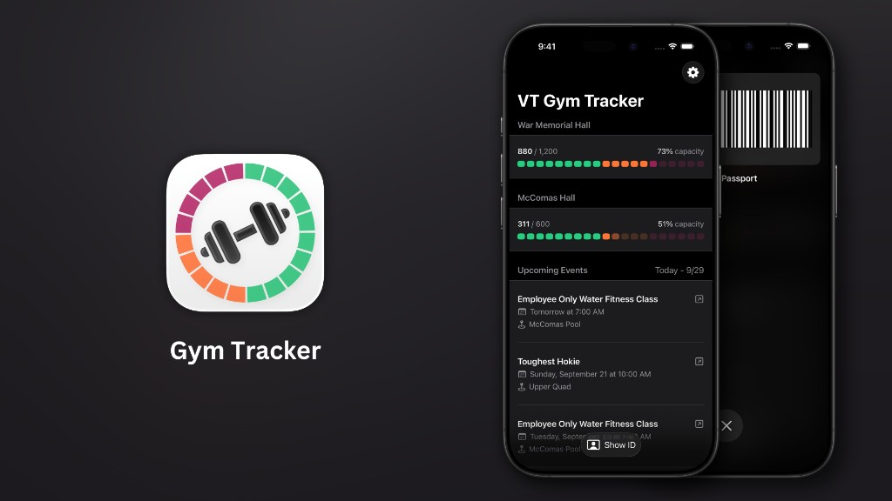

# Gym Tracker

iOS app for tracking Virginia Tech gym occupancy and displaying campus events. Supports iOS, watchOS, and WidgetKit extensions.

<p align="center">
  
</p>

<p align="center">
  <a href="https://apps.apple.com/us/app/vt-gym-tracker/id6736409867?itscg=30200&itsct=apps_box_badge&mttnsubad=6736409867" style="display: inline-block;">
    
  </a>
</p>

<p align="center">
  <a href="https://github.com/Hann8n/VTGymTracker">GitHub</a> · <a href="https://tangled.org/jack.orbyt.video/VTGymTracker">Tangled</a>
</p>

## Architecture

### Core Services

**GymService** (`GymService.swift`)
- Singleton `@MainActor` class managing gym occupancy state
- Publishes `@Published` properties: `mcComasOccupancy`, `warMemorialOccupancy`, `boulderingWallOccupancy`
- Automatic refresh: 30-second interval when app is active (via `UIApplication.didBecomeActiveNotification`)
- Retry logic: 60-second delay if all fetches fail
- Uses `GymOccupancyFetcher` for data fetching

**GymOccupancyFetcher** (`GymOccupancyFetcher.swift`)
- Static enum performing HTTP requests
- Concurrent fetching: `async let` for parallel facility requests
- POST request to `https://connect.recsports.vt.edu/FacilityOccupancy/GetFacilityData`
- Request body: `facilityId={uuid}&occupancyDisplayType={uuid}` (URL-encoded)
- Response: HTML containing `data-occupancy` and `data-remaining` attributes
- Parsing: Delegates to `OccupancyHTMLParser` for regex extraction

**OccupancyHTMLParser** (`OccupancyHTMLParser.swift`)
- Regex-based HTML parsing (no external dependencies)
- Pattern: `data-occupancy="([0-9]+)"` and `data-remaining="([0-9]+)"`
- Extracts occupancy and remaining capacity integers from HTML response

**EventsViewModel** (`EventsViewModel.swift`)
- Uses the shared UI-independent `EventsService` and existing Recreational Sports CampusGroups JSON feed
- Parses source event fields/dates with `CampusGroupsEventsParser`
- Caching: `cachedEvents.json` envelope with events and original successful retrieval metadata
- Filters: Only caches events where `endDate > Date()`
- Network monitoring: Observes `NetworkMonitor.isConnected` via Combine

### Data Flow

**Gym Occupancy:**
1. `ContentView.onAppear` → `fetchGymOccupancyData()`
2. `GymService.fetchAllGymOccupancy()` → `GymOccupancyFetcher.fetchAll()`
3. Concurrent POST requests for three facilities (McComas, War Memorial, Bouldering Wall)
4. HTML response parsed via regex for `data-occupancy`/`data-remaining`
5. Results stored in `GymService` `@Published` properties
6. UI updates via SwiftUI `@ObservedObject` binding

**Events:**
1. `ContentView.onAppear` → `eventsViewModel.fetchEvents()`
2. `EventsService` fetches the CampusGroups JSON feed using async `URLSession`
3. `CampusGroupsEventsParser` validates source records and Eastern-time dates
4. Events filtered by `endDate > Date()`
5. Cached to JSON file, loaded on init if available

**Widgets:**
1. `UnifiedGymTrackerProvider.getTimeline()` called by WidgetKit
2. `GymOccupancyFetcher.fetchForWidget()` fetches occupancy (no remaining capacity)
3. Results stored in App Group UserDefaults (`group.VTGymApp.D8VXFBV8SJ`)
4. Fallback to cached values if fetch fails
5. Timeline policy: `.after(15 minutes)`

### Facility IDs & Capacities

```swift
mcComasFacilityId: "232d714e-5b3e-4b0d-9936-e6a738150ec4"
warMemorialFacilityId: "55069633-b56e-43b7-a68a-64d79364988d"
boulderingWallFacilityId: "da838218-ae53-4c6f-b744-2213299033fc"

mcComasMaxCapacity: 600
warMemorialMaxCapacity: 1200
boulderingWallMaxCapacity: 8
```

### Barcode System

**Storage:**
- `@AppStorage("gymBarcode")` stores Codabar string (e.g., "A12345B")
- Optional `@AppStorage("faceIDEnabled")` for biometric protection

**Scanning:**
- `BarcodeScannerView` uses native AVFoundation capture with a serial session queue.
- On iOS 27.1+, AVKit direction coordination tracks the camera relative to the presenting display; rotation coordination keeps the preview upright.
- Scans Codabar format (`codeTypes: [.codabar]`)
- Validation: Ensures start/end characters are A/B/C/D
- Auto-prefix/suffix if missing: defaults to "A" prefix, "B" suffix

**Generation:**
- `BarcodeGenerator` uses `CDCodabarView` (third-party library)
- Generates `UIImage` from Codabar string
- Displayed in the native `CampusIDSheet`, with a white scan area and brightness restoration via `BrightnessManager`.

**Authentication:**
- `LocalAuthentication` framework for Face ID/Touch ID
- `LAContext.evaluatePolicy(.deviceOwnerAuthenticationWithBiometrics)`
- Triggered before displaying stored barcode if `faceIDEnabled == true`

### App Group & Shared Storage

- App Group ID: `group.VTGymApp.D8VXFBV8SJ`
- Shared UserDefaults keys:
  - `mcComasOccupancy` (Int)
  - `warMemorialOccupancy` (Int)
  - `boulderingWallOccupancy` (Int)
  - `lastFetchDate` (Date)
- Used by: Main app, Widget extension, Watch app

### UI Components

**ContentView:**
- `NavigationStack` with the dashboard scroll container (`DashboardScrollContainer`, field-board background, frosted cards)
- Sections: War Memorial, McComas, Bouldering Wall, optional sponsored ad, events
- `FacilityOccupancyCard` displays each facility with `SegmentedProgressBar`
- Color thresholds: Green (0-50%), Orange (50-75%), Maroon (75-100%)

**Athletic UI:** See [ATHLETIC_STYLE.md](ATHLETIC_STYLE.md) for layout tokens, motion, and component map.

**EventCard:**
- Displays event title, location, time, hosting organization
- Date range: Today through 14 days ahead

### Widget System

**UnifiedGymTrackerProvider:**
- Single timeline provider for all widget sizes
- `getTimeline()` fetches occupancy data
- Stores in App Group UserDefaults
- Timeline refresh: 15-minute intervals
- Widget types: Home screen widgets, Lock screen widgets

### Watch App

- `WatchFacilitiesView` displays gym occupancy
- `WatchGymCardView` shows individual facility status
- `WatchSegmentedProgressBar` visual indicator
- Shares data via App Group UserDefaults

### Dependencies

- **CDCodabarView**: Codabar barcode generation
- **SwiftUI**: UI framework
- **Combine**: Reactive data flow
- **WidgetKit**: Widget system
- **LocalAuthentication**: Biometric authentication
- **AVFoundation**: Camera access for barcode scanning

### Build Requirements

- iOS 17.0+
- watchOS 10.0+
- Xcode 27.1+ (for the Duo SDK; deployment remains iOS 17+)
- Swift 5.9+

### Project Structure

```
Gym Tracker (RC)/
├── Services/
│   ├── GymService.swift              # Main occupancy service
│   ├── GymOccupancyFetcher.swift     # HTTP fetching
│   ├── OccupancyHTMLParser.swift     # Regex HTML parsing
│   ├── Constants.swift                # Facility IDs, capacities, URLs
│   └── UnifiedGymTrackerProvider.swift # Widget timeline provider
├── Events/
│   ├── EventsViewModel.swift         # Shared events service & cache display
│   └── Event.swift                    # Event model
├── BarCode Scanner/
│   ├── BarcodeScannerView.swift      # Camera scanning UI
│   ├── BarcodeGenerator.swift        # Codabar image generation
│   ├── BarcodeDisplayView.swift      # Display overlay
│   ├── ManualIDInputView.swift       # Manual entry UI
│   └── BrightnessManager.swift       # Screen brightness control
├── ContentView.swift                 # Main app view
├── Dashboard*.swift, MotionPolicy.swift  # Dashboard visual system (see ATHLETIC_STYLE.md)
└── SegmentedProgressBar.swift        # Occupancy bar (main app + shared targets)

GymTrackerWidget/                      # Widget extension
GymTrackerWatch Watch App/             # Watch app
GymTrackerComplications/               # Watch complications
```

### License

This project is licensed under the **MIT License**. See the [LICENSE](LICENSE) file for full text.

[Privacy Policy](https://gymtracker.jackhannon.net/docs/privacy-policy.html)

---

*Virginia Tech is not associated with this project*

### Siri and Shortcuts

Ask “What are the crowds like at VT Gyms?” or “What are the crowds like at McComas Hall using Gym Tracker?” **Check Current Crowds** defaults to McComas and War Memorial, the two full-service gyms; bouldering is separate. Ask “Which gym should I go to with Gym Tracker?” for a crowd-based choice with **Choose a Less Crowded Gym**. Responses lead with fullness; typed results still include raw counts, capacity, and freshness. See [the result contract and verification guide](docs/SIRI_CURRENT_CROWDS.md).

## Siri and Shortcuts

[Current crowds](docs/SIRI_CURRENT_CROWDS.md) and [recreation events](docs/SIRI_EVENTS.md)
return typed factual results and spoken responses without opening the app.

## Releasing

iOS and Android ship the same version. `scripts/set_version.py` in Hann8n/Gym-Tracker---Android sets both versions and bumps the iOS build number. Tag both repos `v<version>` to release. See that repo's README for the full flow.

One-time Xcode Cloud change, so a `v*` tag sends a build to TestFlight. Releases already build in Xcode Cloud from `main`.

1. In Xcode, go to Product > Xcode Cloud > Manage Workflows, and open the release workflow.
2. Under Start Conditions, add **Tag Changes**, with tags beginning with `v`. Keep or remove the `main` branch condition to taste.
3. Check that the Archive action uses TestFlight deployment preparation and that a TestFlight post-action is set, then save.
